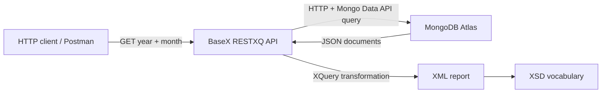

# Phone for You — MongoDB, BaseX and XML Integration

Academic project developed for **PEI (2023/2024)**. The case study models the monthly exchange of smartphone **sales and returns reports** between retail partners and the fictional company *Phone for You*.

The project demonstrates integration between **MongoDB Atlas**, **MongoDB aggregation pipelines**, **BaseX/RESTXQ**, **HTTP**, **XQuery**, **XML** and **XSD**.

> The original submission was a group project. This public portfolio version omits the other students' identifying information, removes credentials and large generated datasets, and contains a small number of maintenance corrections documented in `PORTFOLIO_CHANGES.md`.

## Architecture



The two principal REST resources are:

- `GET /Vendas?year=YYYY&month=MM` — monthly sales report.
- `GET /Refund?year=YYYY&month=MM` — monthly returns report.

Auxiliary resources expose customer, sales and return statistics.

## Repository structure

```text
Cliente/       Customer aggregation pipeline, XSD and sample data
Produto/       Product/category aggregation pipeline, XSD and sample data
Vendas/        Sales pipeline/BaseX resource, XSD and sample XML/JSON
Devolucoes/    Returns pipeline/BaseX resource, XSD and sample XML/JSON
StatsCliente/  Three-year customer statistics
StatsVendas/   Monthly sales statistics
StatsRefund/   Monthly return statistics
CONFIGURATION.md
PORTFOLIO_CHANGES.md
```

Files ending in `.sample.json` or `.sample.xml` are intentionally small representative examples. The full generated exports from the academic work were hundreds of megabytes and are intentionally excluded from the repository.

## Main concepts demonstrated

- Document-oriented modelling in MongoDB.
- MongoDB aggregation pipelines.
- HTTP access to MongoDB Atlas Data API.
- RESTXQ resources in BaseX.
- XQuery transformation from MongoDB's JSON/XML representation into domain XML.
- XML vocabularies and XSD validation.
- Monthly sales/returns filtering.
- Customer classification (`novo`, `regular`, `premium`).
- Product categorisation and sales/return statistics.
- Early-return calculation (within three days).

## Running the BaseX resources

1. Configure MongoDB Atlas and import the source dataset into the collections expected by the pipelines.
2. Set `MONGODB_DATA_API_KEY` and `MONGODB_DATA_API_URL` as described in `CONFIGURATION.md`.
3. Place/adapt the relevant `BaseX.txt` modules in your BaseX web application.
4. Start the BaseX HTTP server.
5. Request a resource, for example:

```text
/Vendas?year=2023&month=10
/Refund?year=2023&month=10
```

The project keeps the original academic file layout and `.txt` extension used for the XQuery/BaseX artefacts rather than redesigning the submission.

## XML schemas

The repository contains XSD vocabularies for customers, products, sales, returns and statistical reports. The sample XML files are small versions of generated output and can be used to inspect the expected report structure.

## Security and public-repository notes

No API key is committed. The original hard-coded key was removed during portfolio preparation. The MongoDB Data API URL was also externalized so the public repository does not expose the original deployment identifier.

The full generated datasets and the original group report are intentionally excluded from this portfolio version. The report contained identifying information for other group members and is not required to understand or run the technical artefacts.
